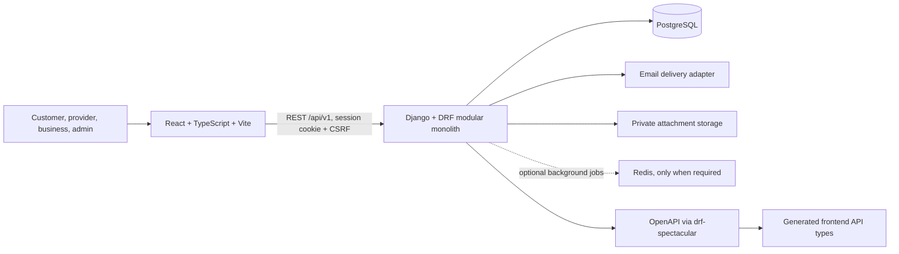

# HiddenStage Architecture

## Status

Target architecture based on the HiddenStage restart prompt. It is not yet implemented. This document will be updated as the independent repositories are established and verified.

## System shape

HiddenStage starts as a modular monolith with independently installable frontend and backend repositories. The backend owns authorization, validation, state transitions, and persistence. The frontend consumes the versioned REST API; it is never a security boundary.

## Repository boundaries

- `hiddenstage-frontend`: React, TypeScript, Vite, React Router, responsive UI, API client, and generated OpenAPI types.
- `hiddenstage-backend`: Python 3.12+, Django 5.2 LTS, Django REST Framework, PostgreSQL, drf-spectacular, Docker, and deployment configuration.
- Product-level discovery and decision records live in the workspace `docs/` directory; they are not a third application repository or monorepo.
- No existing repository or user data is to be deleted or repurposed.

## Backend domain boundaries

Accounts, businesses, services, event requests, matching, invitations, quotations, commitments, attachments, notifications, and audit are logical modules within one Django application deployment. Critical business operations belong in service functions/use cases, use atomic transactions and row locks where needed, and retain database constraints for invariants.

## API and data constraints

- REST API prefix: `/api/v1/`.
- OpenAPI is generated from backend contracts; frontend types are generated from that schema, never manually duplicated.
- PostgreSQL is authoritative. Money uses integer paise, timestamps are timezone-aware, and Asia/Kolkata is the default timezone.
- Acceptance and release operations preserve audited history and enforce the approved state rules under concurrency.
- Session authentication uses HttpOnly cookies and CSRF protection; no authentication token is stored in localStorage.
- Attachments are private by default, downloads are authorized, and storage must expose a malware-scanning integration point.

## External integrations

Email delivery, private object storage, malware scanning, and analytics require explicit environment configuration and verification. Redis is introduced only when a background-work requirement justifies it. Core marketplace behavior must not depend on analytics.

## Not yet decided

Production hosting and domain topology, mail provider, object-storage provider, malware scanning vendor, Redis-backed job framework, and environment-specific CORS/CSRF origins are not specified. Do not choose these silently.
