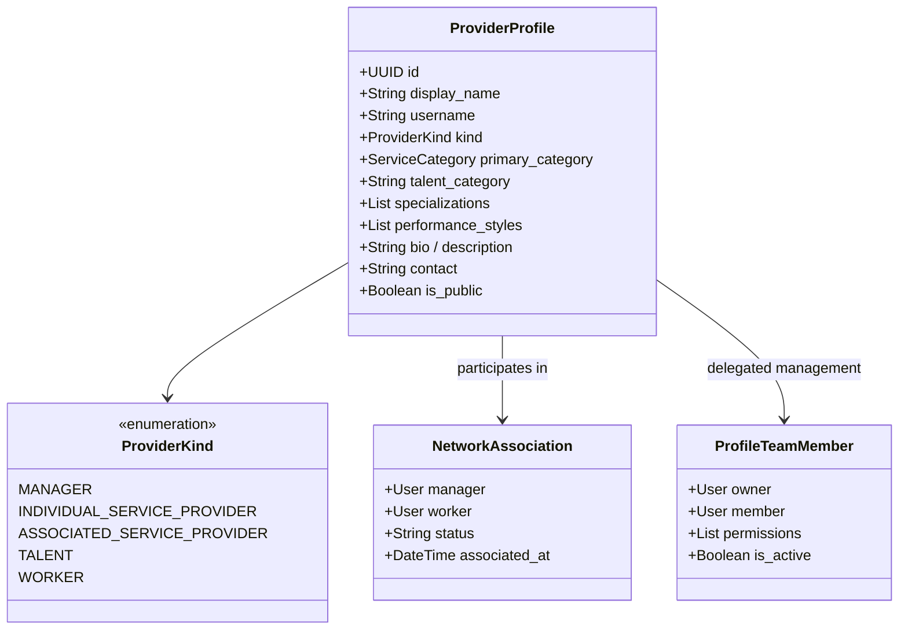

# HiddenStage Professional Identity Architecture

## Overview

HiddenStage establishes a clear distinction between:
1. **Account Identity** (`User.role`): Either `CUSTOMER` or `PROVIDER`. This governs core authentication, session management, and primary security barriers.
2. **Professional Participation Type** (`ProviderProfile.kind`): Defines how an event professional operates in the marketplace.
3. **Services & Specializations**: The categories, specializations, and explicit locations covered.
4. **Manager Associations**: Non-exclusive commercial relationships connecting independent professionals and managers.
5. **Permissions & Capabilities**: What operations an account (or an authorized assistant) may execute.

---

## The 5 Professional Types

### 1. MANAGER
- **Description:** Agencies, production houses, and event management firms coordinating end-to-end event execution.
- **Capabilities:**
  - Offer multiple service categories.
  - Submit quotes on complex, multi-service event briefs.
  - Recruit and maintain a network of Workers and Associated Service Providers.
  - Direct assignment of associated workers to committed projects.
  - Grant delegated assistant access to team members.
  - Maintain a full business portfolio with branding (logo, cover banner).

### 2. INDIVIDUAL SERVICE PROVIDER
- **Description:** Independent professionals delivering one specialized craft (e.g. independent photographer, caterer, DJ).
- **Rule:** May select strictly **ONE** primary service category during onboarding. Unrelated service categories are disallowed.
- **Capabilities:**
  - Quote customer requests matching their declared primary service.
  - Independent direct communication and commercial commitments.
  - Independent portfolio and service coverage.
  - Operates completely without needing a Manager association.

### 3. ASSOCIATED SERVICE PROVIDER
- **Description:** Craft professionals who work in association with event managers (e.g. resident decorator, partner catering crew).
- **Account Ownership:** Retains independent account ownership; associations are **non-exclusive** and multiple manager relationships are permitted.
- **Capabilities:**
  - Search managers by name, username, or business name.
  - Submit network association requests (`NetworkInvitation` with `initiated_by="PROFESSIONAL_REQUESTS"`).
  - Accept assignments and quotes from associated managers.

### 4. TALENT
- **Description:** Performing artists, emcees, live musicians, speakers, and celebrity appearances.
- **Identity Distinction:** Not classified as generic event labor.
- **Capabilities:**
  - Dedicated talent category and performance style classification.
  - Showcase performance videos, showreels, and audio/visual media links.
  - Maintain public talent profile with performance history.
  - Receive targeted talent booking inquiries and opportunities.

### 5. WORKER
- **Description:** Operational, ground-level, and logistics personnel (e.g. security, ushers, registration staff, setup crew).
- **Capabilities:**
  - Specify operational skills and roles.
  - Upload certificates and documentation.
  - Receive direct assignment invitations from associated Managers.
  - View assignment history and maintain availability status.
  - Retains independent account ownership; never subordinate to a single firm.

---

## Security & Permission Model

### Assistant Delegation Model (`ProfileTeamMember`)
Managers can delegate operational duties to staff without sharing account credentials:
- `MANAGE_BUSINESS_PROFILE`: Edit profile copy, contact, links, cover, logo.
- `MANAGE_PORTFOLIO`: Create, update, reorder, delete portfolio items.
- `MANAGE_SERVICES`: Manage service lines, pricing, and geographic coverage.
- `MANAGE_TEAM`: Add/remove other team assistants.
- `VIEW_EVENTS`: View customer opportunities and event details.
- `MANAGE_EVENTS`: Submit quotes and respond to invitations.

**Security Constraints:**
- Assistants cannot alter the Manager's login email or password.
- Assistants cannot transfer account ownership.
- All mutating actions record the acting user in audit logs.
- Revocation of `is_active` instantly terminates delegated permissions.
